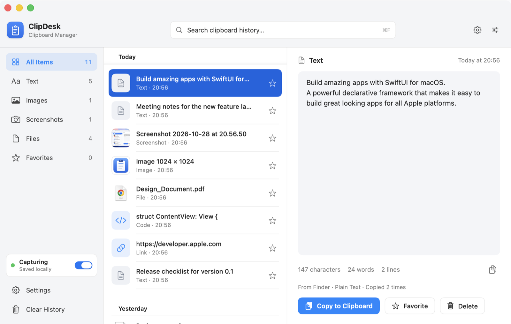
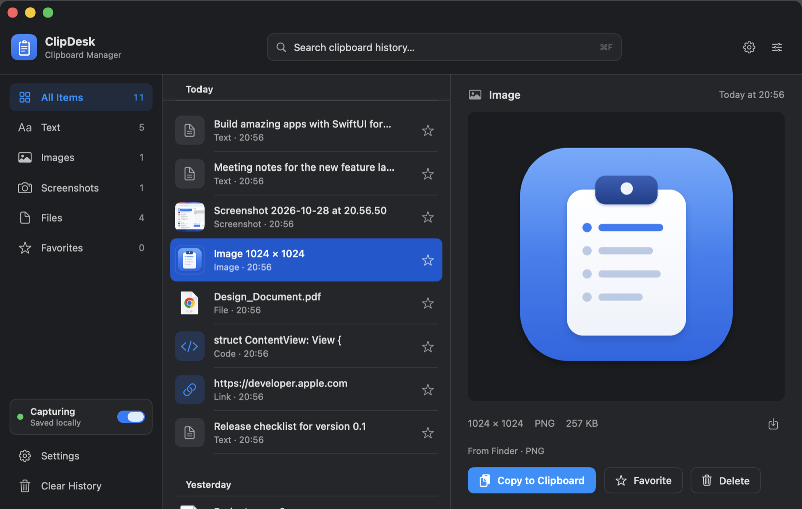

# ClipDesk

ClipDesk is a native macOS clipboard and screenshot manager. It records what you copy (text, code, links, images, screenshots and files), keeps a searchable local history, and copies any item back to the clipboard with its original formats.

It is written in Swift with SwiftUI and AppKit. It runs in the menu bar and opens a full history window on demand. History is stored on your Mac only.





*Rendered from the running app with test data.*

## Features

**Clipboard capture**
- Watches the general pasteboard by polling its `changeCount` (every 0.5 s by default, configurable). Contents are read only when the count changes, on a background queue.
- Keeps **every representation** of each pasteboard item (for example plain text, RTF and HTML together), and keeps **multiple items** of one copy as a single history entry.
- Classifies entries as text, code, link, image, screenshot, file(s) or other data.
- Detects screenshots by macOS screenshot file names (several languages, plus CleanShot) and by the `Screenshot` EXIF comment that macOS writes into screenshot images.
- Skips content that apps mark as concealed or transient ([nspasteboard.org](https://nspasteboard.org) markers used by password managers). This can be turned off in Settings › Privacy.
- Copying an item back from ClipDesk never creates a duplicate entry. ClipDesk recognizes its own writes and moves that item to the top instead.
- Pause and resume capture from the menu bar, the history window, the History menu (⇧⌘P) or Settings. Nothing copied while paused is recorded.

**Files**
- A copied file is stored as a reference (original path) **and**, when readable and within the size limit, as a managed copy. The item stays usable after the original is moved or deleted.
- Each file shows its availability (*Available*, *Original moved or deleted — stored copy available*, *Unavailable*) and why a copy was or wasn't kept (too large, folder, unreadable, copying disabled).
- Copying a file entry back puts real file URLs on the clipboard, so you can paste the files in Finder, Mail and other apps. Multi-file copies are restored as a group.

**History window** (layout follows `docs/design/main-window-reference.png`)
- Sidebar: All Items, Text, Images, Screenshots, Files, Favorites, with live counts. Settings and Clear History sit at the bottom, along with a capture on/off switch.
- Center: search (⌘F), entries grouped by day, thumbnails, file icons, relative timestamps and favorite stars.
- Right: a detailed preview. Text uses a fast text view with character, word and line counts; code is monospaced. Images are shown aspect-fit. Files get a Quick Look preview plus metadata. Each preview has Copy to Clipboard, Favorite and Delete, and context actions such as Copy as Plain Text, Open Link, Save Image, Open and Reveal in Finder.
- Light and Dark Mode, resizable down to 760 × 480 pt with a compact icon-only sidebar on narrow windows.

**Menu Bar popover**
- Status, a pause button and Settings in the header, then search and the 60 most recent items, each with a quick copy button.
- Keyboard: ↑/↓ to move, Return to copy and close, ⌘O to open the full history, ⌘F to search.

**Settings**
- **General:** capture on/off, polling interval, appearance (System/Light/Dark), open at login (via `SMAppService`).
- **Storage:** history size, retention period, file copies on/off, per-item size limit, storage usage, Show in Finder, Clear History and Delete All Data.
- **Privacy:** skip private content, plus a plain-language description of how data is handled.

### Keyboard shortcuts

| Where | Shortcut | Action |
|---|---|---|
| History window | ⌘F | Search |
| History window | ⌘1 … ⌘6 | Switch category |
| History window | ↑ / ↓, Return, Delete | Move, copy, delete selected item |
| History window | ⌘D | Toggle favorite |
| Anywhere in ClipDesk | ⇧⌘P | Pause / resume capture |
| Menu Bar popover | ↑ / ↓, Return, ⌘O | Move, copy, open full history |

ClipDesk does not register global hotkeys and never intercepts ⌘C or ⌘V.

## Requirements

- macOS 14 Sonoma or later. The app uses `MenuBarExtra`, the Observation framework, `SettingsLink` and `onKeyPress`, which require macOS 14.
- Apple silicon or Intel. Release builds are universal.

## Install from the DMG

1. Open `ClipDesk-<version>.dmg` and drag **ClipDesk** onto **Applications**.
2. Open ClipDesk from Applications. It appears in the menu bar as a clipboard icon and opens its history window.

**Signing status: ad-hoc signed, not notarized.** No Developer ID certificate is configured for this project, so macOS Gatekeeper blocks the first launch (`spctl` reports *rejected*). To open it anyway:

- **macOS 15 or later:** try to open ClipDesk once, then go to **System Settings › Privacy & Security** and click **Open Anyway**.
- **macOS 14:** Control-click ClipDesk in Applications, choose **Open**, then confirm.

Only do this for builds from this repository. Compare the download with the published `.sha256` checksum.

## Build from source

Prerequisites: macOS 14+, and either Xcode 16+ or the Xcode Command Line Tools with Swift 6 (`xcode-select --install`). No third-party dependencies.

```sh
scripts/test.sh                      # run the test suite (Swift Testing)
scripts/build-app.sh                 # Release build → build/ClipDesk.app (arm64)
scripts/build-app.sh --universal     # arm64 + x86_64
scripts/build-app.sh --debug         # Debug build
scripts/package-dmg.sh               # build/ClipDesk-<version>.dmg (+ .sha256), verified after creation
open build/ClipDesk.app
```

The project is a Swift package. Open `Package.swift` in Xcode to edit, build and run the tests. The `.app` bundle (Info.plist, icon, signature) is assembled by `scripts/build-app.sh`, so use that script to produce a runnable app. See [docs/BUILDING.md](docs/BUILDING.md) for details, environment variables and the CI setup.

## Privacy

- **Local only.** History, thumbnails and file copies live in `~/Library/Application Support/ClipDesk/`. ClipDesk makes no network connections and has no analytics or telemetry.
- **What is skipped.** Content marked concealed or transient by its source app, content copied while capture is paused, and anything already on the clipboard when ClipDesk starts.
- **Logs** contain counts, types and errors, never clipboard contents.
- **Deleting** an item removes its database rows (SQLite `secure_delete` is on) and its payload folder. *Delete All Data* also compacts the database. Like any app on SSD storage, ClipDesk cannot guarantee forensic erasure.
- **Not a vault.** History is not encrypted. Anyone with access to your macOS account can read it.
- **File access.** Copying files from Desktop, Documents or Downloads may make macOS ask whether ClipDesk can access that folder. If you decline, ClipDesk keeps only a reference.

## Storage and retention

| Setting | Default | Options |
|---|---|---|
| History size | 100 items | 25 – 1,000 |
| Retention | 30 days | 1 day – 1 year, or never |
| Max size per item | 100 MB | 10 – 500 MB |
| Keep copies of copied files | On | On / Off |
| Polling interval | 0.5 s | 0.25 – 2 s |

- Age is measured from an item's **last activity** (copied again, or copied back from ClipDesk).
- **Favorites are never removed automatically.** The size limit counts non-favorite items.
- **Duplicates:** copying identical content again moves the existing item to the top, keeps its first-copied date and increments its copy count. If the same text, image or files arrive with different formats (for example plain text, then rich text), the stored formats are replaced with the newest ones.
- Retention runs after every capture, at launch and hourly. Orphaned payload folders are removed at launch.

## Known limitations

- **Not notarized** (see above). Release workflow steps for Developer ID signing and notarization exist, but they have never run because no credentials are configured.
- **Clipboard screenshots** are recognized by the `Screenshot` EXIF comment. This was tested with images carrying that metadata, not with a live ⌃⇧⌘4 capture: the development environment had no Screen Recording permission. Screenshot *files* are also recognized by name.
- **Source app** is the app that was frontmost when the copy was detected. macOS does not report which process wrote to the pasteboard, so this is best effort.
- **Formats not retained:** file promises (not read, to avoid making the source app write files); TIFF when a PNG of the same image exists; synthesized UTF‑16 text when UTF‑8 exists; unknown custom types over 2 MB; anything over the per-item limit. Omitted formats are listed in the item's details.
- **Folders** are kept as references, not copied.
- **Quick Look previews** use the system `QLPreviewView`. Its rendering could not be captured in automated UI checks because it draws out-of-process.
- **Open at login** uses `SMAppService` and is most reliable when ClipDesk is in /Applications. It has not been exercised in automated testing.
- **No global hotkey** in this version.
- **Rich previews:** rich text is previewed as plain text, but it is restored with all of its formats.

## Project documentation

- [docs/ARCHITECTURE.md](docs/ARCHITECTURE.md): modules, capture lifecycle, persistence design.
- [docs/BUILDING.md](docs/BUILDING.md): build scripts, tests, packaging, CI and release workflows.
- `docs/design/main-window-reference.png`: the design reference for the history window.
